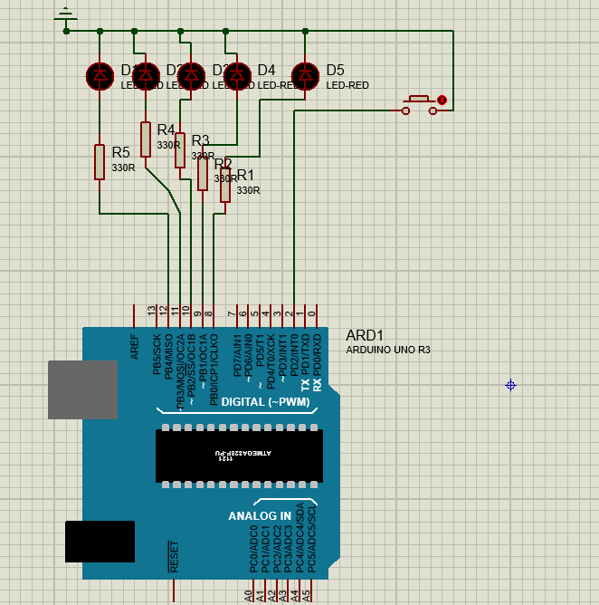

# AVR Microcontroller Interfacing 🚀

> Practical embedded systems tasks implemented using ATmega328P with low-level register manipulation, compiled via Arduino IDE, and simulated in Proteus VSM.

---

## 📋 Table of Contents
- [Project Overview](#-project-overview)
- [Task 1: Rotating 8 LEDs Right](#-task-1-rotating-8-leds-right)
- [Task 2: Pattern Toggle via Push-Button (5 LEDs)](#-task-2-pattern-toggle-via-push-button-5-leds)
- [License](#-license)

---

## 📊 Project Overview
This academic project focuses on low-level hardware interfacing, direct port manipulation (`DDRx`, `PORTx`, `PINx`), bit masking, and handling timing/interrupts or polling mechanisms on an 8-bit AVR RISC microcontroller.

---

## 💡 Task 1: Rotating 8 LEDs Right

### 🔹 Description
* **Group Size:** Up to 5 members[cite: 1].
* **Objective:** Rotate an active LED light pattern to the right across **8 LEDs** connected to the microcontroller ports[cite: 1].
* **Timing:** Use a precise period of **0.25 seconds (250 ms)** between each shift[cite: 1].
* **Output:** 8 LEDs driven by PORTD[cite: 1].

### 🛠️ Simulation & Implementation
The 8 LEDs are connected to **PORTD** (`PD0` through `PD7`) via `330Ω` current-limiting resistors, with their cathodes tied to a common Ground (`GND`).

<table>
  <tr>
    <td align="center">
      
       
      <b>Task 1 Simulation</b>
    </td>
    <td align="center">
      
       
      <b>Circuit Schematic</b>
    </td>
  </tr>
</table>

---

## 🔘 Task 2: Pattern Toggle via Push-Button (5 LEDs)

### 🔹 Description
* **Objective:** Toggle or sequence specific patterns across **5 LEDs** progressively each time a hardware push-button is pressed[cite: 40].
* **Sequence Pattern & Timeline:** The system follows the exact multi-step transition table from $t = 0$ to $t = 10$ as defined in the specifications[cite: 40]:
  * **t = 0:** All LEDs OFF (00000)[cite: 40].
  * **t = 1:** First LED ON (10000)[cite: 40].
  * **t = 2:** First and second LEDs ON (11000)[cite: 40].
  * **t = 3:** First, second, and third LEDs ON (11100)[cite: 40].
  * **t = 4:** First four LEDs ON (11110)[cite: 40].
  * **t = 5:** All 5 LEDs ON (11111)[cite: 40].
  * **t = 6 to 10:** Progressive shifting and clearing as outlined in the matrix.

### 🛠️ Circuit Logic & Behavior
* **Button Interfacing & Polling:** Uses digital input polling or hardware interrupts (`INT0` / `INT1`) to detect button presses[cite: 10, 35, 36].
* **De-bouncing Consideration:** Mechanical switch bouncing is handled using hardware de-bouncing techniques (such as RC networks with Schmitt-triggers like `74HC14` or proper software delays) to convert noisy analog signals into pristine digital 0s and 1s[cite: 4, 37, 38].

<table>
  <tr>
    <td align="center">
      
       
      <b>Task 2 Setup</b>
    </td>
    <td align="center">
      <!-- حط رابط الصورة الثانية هنا مكان الـ Link ده -->
      
       
      <b>Second Image Title</b>
    </td>
  </tr>
</table>

---

## 📌 Conclusion
Hope this repository makes it easier to review and test the lab tasks. Good luck with the course! 🚀
